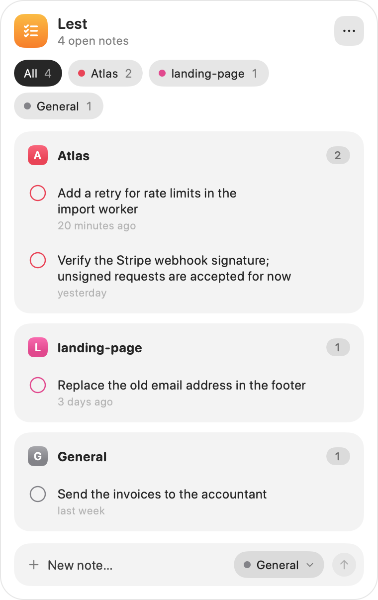

# Lest — “lest I forget”

**A macOS menu bar to-do list for Claude Code and Codex.** Tell your AI coding agent "don't
forget this" and the note stays in your menu bar, filed under the project you were working on,
until you tick it off.

> **lest** *(conjunction)*: for fear that; so that something does not happen.
> *"Write it down, lest you forget."*

<picture>
  <source media="(prefers-color-scheme: dark)" srcset="docs/panel-dark.png">
  
</picture>

## Why

The task list a coding agent keeps lasts for one session. The follow-ups you agree on along
the way ("we should add a retry here later", "remind me to update the docs") end up scattered
over dozens of conversations and projects, and get forgotten. Lest gives them one place that
is always in sight: a persistent to-do list in the menu bar, shared by every project and every
session.

## Features

- **Always in your menu bar.** Click the icon to see your notes project by project; the number
  of open notes sits next to it.
- **Your agent adds the notes.** Say "don't forget this, add it to my to-do list" to Claude Code
  or Codex and the note is added with the `lest` command and shows up right away.
- **Grouped by project.** The project is the folder (the git repository) the agent was working
  in, so you always know what a note was about.
- **Works from the panel and the terminal too.** Add, complete and delete notes by hand, or
  script it with `lest add` and `lest list --json`.
- **A native Mac app.** Written in Swift and SwiftUI, signed and notarized, for Apple silicon
  and Intel.
- **Local and private.** Your notes are one JSON file on your Mac. No account, no cloud;
  nothing leaves your computer.
- **Any language.** Notes are stored as you or your agent wrote them.
- **Free and open source**, under the MIT license.

## Install

Lest needs macOS 14 or later and runs on Apple silicon and Intel Macs.

1. Download [Lest.zip](https://github.com/yusufkaran/lest/releases/latest/download/Lest.zip),
   unzip it and move `Lest.app` into your Applications folder. The app is signed and notarized.
2. Open Lest. It appears in the menu bar and adds itself to your login items; you can turn that
   off in the panel's ⋯ menu.
3. Put the `lest` command on your `PATH` and connect your coding tools:

```bash
sudo mkdir -p /usr/local/bin
sudo ln -sf /Applications/Lest.app/Contents/MacOS/Lest /usr/local/bin/lest
lest setup
```

The app's executable doubles as the command, so the link is all it takes. Any folder on your
`PATH` works in place of `/usr/local/bin`.

To update, download the new version and replace the app. To uninstall:

```bash
lest setup --remove                       # remove the files written for the coding tools
pkill -x Lest
sudo rm /usr/local/bin/lest
rm -r /Applications/Lest.app
rm -r ~/Library/Application\ Support/Lest   # your notes; skip this to keep them
```

### Build from source

With Xcode 16 or later (Swift 6):

```bash
git clone https://github.com/yusufkaran/lest.git
cd lest
make install
```

This builds the app and installs it as `/Applications/Lest.app`, links the `lest` command into
`~/.local/bin`, connects the coding tools it finds on this Mac, and opens the app.
`~/.local/bin` has to be on your `PATH` for the coding tools to find `lest`; the install tells
you when it is not. To link the command into another folder instead:

```bash
make install COMMAND=/usr/local/bin/lest
```

## Connecting Claude Code and Codex

```bash
lest setup                   # connect every tool found on this Mac
lest setup codex             # connect just one
lest setup --status          # which ones are connected
lest setup --remove codex    # disconnect
```

Connecting a tool does two things: it installs the skill that teaches the tool when to run
`lest`, and it lets the tool run the command without asking. Lest only writes files of its own
for this and never edits the tool's settings, so disconnecting is deleting those files.

| Tool | Files written |
|---|---|
| Claude Code (`claude`) | `~/.claude/skills/lest/SKILL.md`; the permission is in the skill's `allowed-tools` lines |
| Codex (`codex`) | `~/.agents/skills/lest/SKILL.md` and `~/.codex/rules/lest.rules` |

The permission covers `add`, `list`, `projects`, `done`, `undone` and `show`; `lest rm` asks
every time. When the app is updated, it brings the files of connected tools up to date itself.

Claude Code asks before using a skill that carries permissions. Choose "don't ask again" when
it first asks, or add `Skill(lest)` to your allow list, and it will not ask again. Codex reads
its rules at startup, so restart sessions that were open when you connected it.

Other tools that read skills from `~/.agents/skills`, such as Cursor, find the skill there once
Codex is connected; they have not been tested with Lest. For anything else, the skill is in this
repository: `skill/lest/SKILL.md`.

## The command

```bash
lest add "Verify the Stripe webhook signature"   # project: the current folder
lest add "Update the footer" --project Landing
lest list --here                                 # open notes of this project
lest list --all                                  # including completed notes
lest done 3f2a                                   # the first characters of the id are enough
lest rm 3f2a
lest projects
lest show                                        # opens the panel on screen
```

The app's executable is this command as well: when its first argument is a command it runs
that and exits, otherwise it starts as the menu bar app.

## Data

Notes live in `~/Library/Application Support/Lest/notes.json`. The app and the command share
that file; every change is made under a file lock, and the app watches the folder and shows
changes by itself. The `LEST_DIR` environment variable points both at another folder, which is
handy for experiments.

## Development

```bash
make test       # unit tests
make snapshot   # draws the panel with sample notes into build/snapshots
make icons      # compiles the SVG files in Resources/Phosphor into Swift
make skill      # compiles skill/lest/SKILL.md into Swift
make app-icon   # regenerates Resources/AppIcon.icns
make release    # the signed, notarized download; see the Makefile for what it needs
```

There are two ways to look at an interface change: `make snapshot` draws the panel off screen,
and `lest show` opens the real panel of the running app.

- `Sources/LestCore`: the note model, the file store, project detection, the command line and
  the tool connections
- `Sources/Lest`: the menu bar item and the panel window (AppKit), and the panel's contents
  (SwiftUI)
- `Resources/Phosphor`: the icons in the panel ([Phosphor Icons](https://phosphoricons.com),
  MIT). To add one, put its SVG file there and run `make icons`.
- `skill/lest/SKILL.md`: when and how a connected tool adds a note. Run `make skill` after
  editing it.

To support another coding tool, add a case to `Sources/LestCore/Connections/CodingTool.swift`:
it names the tool's settings folder, where its skill goes and the files to write.
